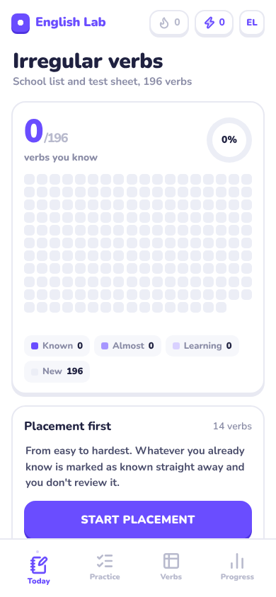
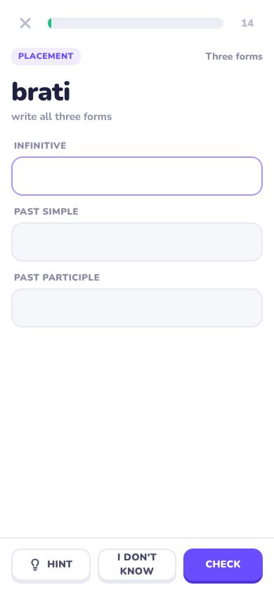
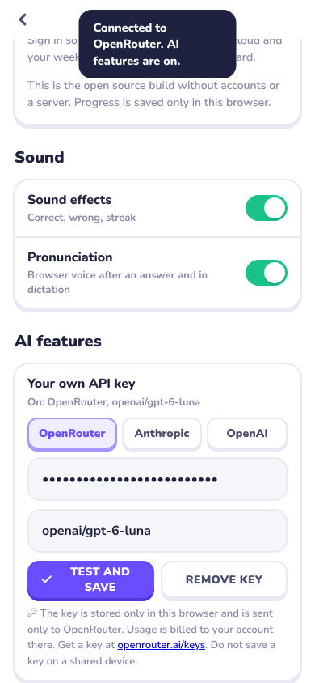

# English Lab

English practice app for Slovenian students: all 196 irregular verbs, grammar drills, test style checks and spaced repetition that keeps bringing back what you got wrong.

This is the **open source build** of [English Lab](https://english.xtrslab.com). It runs entirely in the browser: no accounts, no server and no API keys built in. Progress is saved in `localStorage`. The interface is in English; verb meanings and a few translation tasks stay in Slovenian, because the app trains Slovenian speakers.

AI features are **optional**: add your own OpenRouter, Anthropic or OpenAI key in Settings and they switch on. Without a key everything else works offline.

<p align="center">
  
  &nbsp;&nbsp;
  
</p>

## Features

* **196 irregular verbs** with Slovenian meanings, three forms and accepted variants
* **Placement test** that marks what you already know, so you never drill it again
* **FSRS 5 spaced repetition** with adaptive difficulty: tasks sit at the edge of what you know
* **Test mode** in the order of a real mock test, graded at the end
* **Quick games**: 60 second sprint, crossword, picture naming
* **Arena**: 8 fast questions against bots with realistic skill levels and timing
* **Grammar banks**: present tenses, articles, nouns, vocabulary for tests
* **Weak spot tracking**: mistakes come back as similar tasks until they stick
* **Bring your own AI key** (OpenRouter, Anthropic or OpenAI): fresh test items, “Why is it wrong?” explanations, grading of explanations and writing, smarter answer checking
* Installable PWA, works offline after the first load

## What is different from the hosted version

| Hosted version | Open source build |
|---|---|
| Accounts (Google, email code) and cloud sync | No accounts, progress stays in this browser |
| AI on the server, paid by the app | AI with your own key, called straight from your browser |
| AI generated fresh test items | Bundled test bank, plus fresh items when a key is set |
| Natural voice recordings | Browser speech synthesis |
| Weekly league and live multiplayer Arena | Arena against bots only |

The server layer was replaced by a small local module (`src/lib/supabase.ts`) with the same interface, so the rest of the code is unchanged and easy to read.

## AI with your own key

Open **Settings → AI features**, pick a provider, paste your key and press **Test and save**.

<p align="center"></p>

| Provider | Default model | Where to get a key |
|---|---|---|
| OpenRouter | `openai/gpt-6-luna` | [openrouter.ai/keys](https://openrouter.ai/keys) |
| Anthropic | `claude-haiku-5-5` | [console.anthropic.com](https://console.anthropic.com/settings/keys) |
| OpenAI | `gpt-6-luna` | [platform.openai.com/api-keys](https://platform.openai.com/api-keys) |

You can type any other model ID your account has access to. How it works:

* The key is stored only in your browser (`localStorage`) and sent only to the provider you picked, directly from the browser. No server of mine ever sees it.
* Usage is billed to your own account with that provider. The app uses small, cheap models by default.
* Anyone with access to the browser profile can read the key, so do not save it on a shared device. **Remove key** deletes it.
* All calls live in `src/lib/llm.ts` (providers) and `src/lib/ai.ts` (prompts). Every AI feature falls back to offline behaviour on any error.

## Run it

```bash
npm install
npm run dev      # http://localhost:5173
npm run build    # static files in dist/
```

Deploy `dist/` to any static host (Cloudflare Pages, Netlify, GitHub Pages).

### Optional: verb recordings

Put MP3 files in `public/audio/v2/<verb>.mp3` and set `HAS_VERB_AUDIO = true` in `src/lib/speech.ts`.

## Stack

React 19, TypeScript, Vite, Framer Motion, Tailwind CSS, vite-plugin-pwa.

## License

MIT, see [LICENSE](LICENSE). Made by [Nik Bogataj](https://github.com/nikb12e) · [XTRSlab](https://xtrslab.com).
